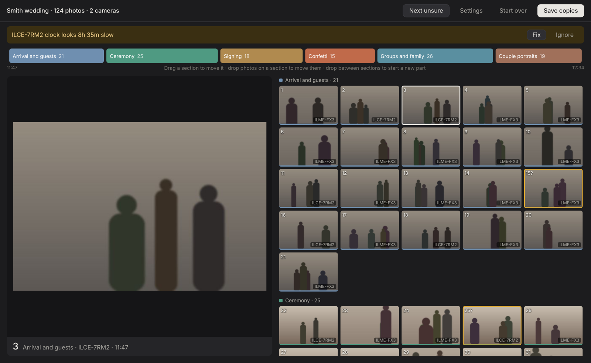
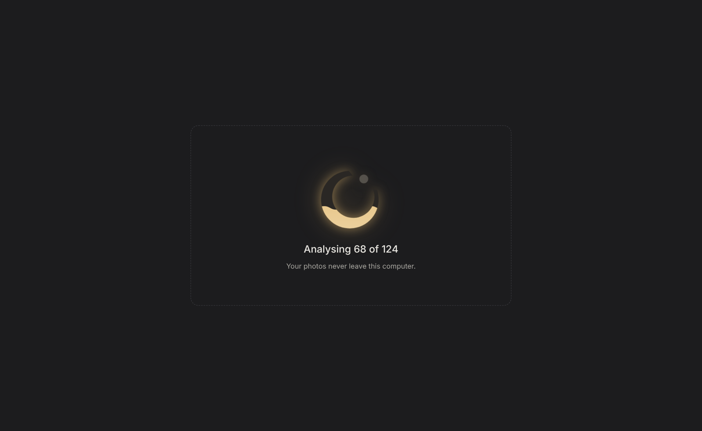
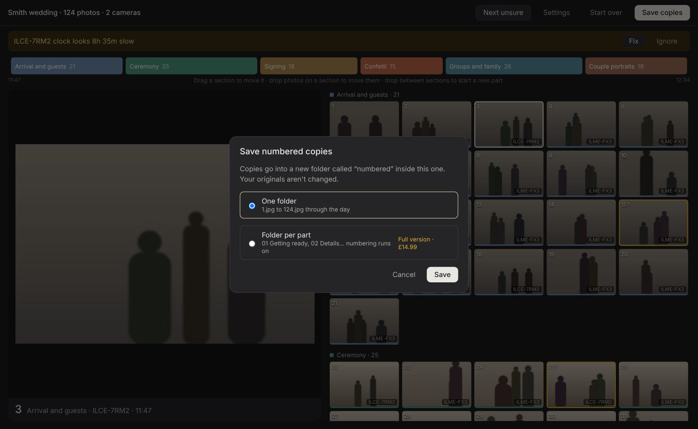

<p align="center">
  <picture>
    <source media="(prefers-color-scheme: dark)" srcset="docs/images/logo-dark.svg">
    
  </picture>
</p>

<h3 align="center">Every camera, one day, in order.</h3>

<p align="center">
  A desktop app for wedding and event photographers and filmmakers. Zen Sync puts the finished photos and video clips
  from all your cameras back into the order the day happened, then numbers them and files them into folders for you, entirely on your own computer.
</p>

<p align="center">
  <a href="#download"><b>Download</b></a> ·
  <a href="#how-it-works">How it works</a> ·
  <a href="#free-and-full-version">Pricing</a> ·
  <a href="#questions">Questions</a>
</p>

<p align="center">
  
</p>

---

## The problem it solves

You've finished editing a wedding in Lightroom and exported the JPEGs. But:

- **Your cameras don't line up.** `DSC…` files from one body and `_MG_…` files from another sort into two separate blocks, not one day.
- **The times can't be trusted.** One camera's clock was never set, or reset itself to 2015 when the battery came out.
- **The times can be missing entirely.** Lightroom exports set to "Copyright Only" metadata strip the capture time.

So you end up dragging hundreds of photos into order by eye, then renaming them by hand.

**Zen Sync does that for you.** It looks at each photo, works out which part of the day it shows, lines every camera up, and puts the whole day in order. You check it, fix anything you disagree with, and save numbered copies. It takes minutes, not an evening.

## Who it's for

- **Wedding photographers** shooting with two or more cameras, or with a second shooter.
- **Event photographers:** corporate events and conferences, parties and birthdays, christenings and engagement shoots each have their own running order built in.
- **Anyone delivering a wedding as one numbered set:** galleries, albums, USB deliveries and slideshows all read better in order.
- **Photographers who care where their clients' photos go.** Zen Sync never uploads anything.

- **Photo and video teams:** video clips from the same day are placed in order alongside the photos, with timecode lists ready for Premiere or DaVinci Resolve.

It works on finished JPEG exports, not RAW files, so it fits in after your edit and before delivery.

## How it works

<p align="center">
  
</p>

1. **Drop in the job's folder**, or send photos straight from your editor (see below). Photos and video clips inside sub-folders are found too, so a folder with `Camera A/`, `Camera B/` and `Video/` inside is sorted as one day. Zen Sync **works out what kind of event it is** (wedding, corporate event, party or birthday, christening or engagement shoot), or you can choose one yourself.
2. **Zen Sync looks at every photo** and recognises the parts of the day. For a wedding that's getting ready, details, arrival, ceremony, signing, confetti, drinks, groups, couple portraits, breakfast, speeches, cake, first dance and the evening; a corporate event runs from registration through talks, panels, workshops, networking and headshots to awards and dinner.
3. **It lines the cameras up.** If one camera's clock was wrong, it spots the same moment shot by two cameras and offers to correct it: *"A7R II clock looks 8h 35m slow — Fix?"* Cameras with no timestamps at all are slotted in by matching what's in the pictures.
4. **You check the order** on a timeline of the whole day. Photos it isn't sure about are outlined in amber, and **Next unsure** takes you straight to them. If it spots a moment that isn't on your list, such as a sparkler exit or a surprise performance, it offers to add it as a new part.
5. **Fix anything by drag and drop:** select many photos at once (drag a box, Shift-click, Ctrl/Cmd-click or Ctrl/Cmd+A) and move them together, drop them onto a different part of the day, or drag a whole section (say, portraits before confetti). Arrow keys move through the photos and keys 1–9 send them to a part; every shortcut can be changed in Settings.
6. **Save numbered copies**, either as one folder (`1.jpg`, `2.jpg`, …) or as folders and sub-folders for each part of the day, with the numbering running on through the whole day:

   ```
   numbered/
     01 Morning/    01 Getting ready, 02 Details
     02 Ceremony/   01 Arrival and guests, 02 Ceremony, 03 Signing, 04 Confetti
     03 Reception/  01 Drinks reception, 02 Groups and family, …
     04 Evening/    01 First dance, 02 Evening party
   ```

   Video clips go into the same folders as `V001.mp4`, `V002.mp4`… in day order, and a `Timecode` folder holds an EDL of the day for Premiere or Resolve, part-of-day markers for Resolve and a CSV.

7. **Keep the job in sync.** Turn on **Keep in sync** and any photos or clips added to the folder later are put in their place and the numbered copies updated in the background, even with the window closed (Zen Sync waits in the system tray).

<p align="center">
  
</p>

## Works with your editor

Send photos to Zen Sync straight from the app you edit in, and it sorts just the photos you sent:

- **Lightroom Classic:** export with *After Export → Zen Sync* (set it up in one click from **Settings → Editors**).
- **Capture One:** *Open With → Zen Sync* in your export recipe.
- **DxO PhotoLab:** *Export to Application → Zen Sync*.
- **ON1 Photo RAW:** *Send to Other Application → Zen Sync*.
- **darktable:** a *Zen Sync* export target, installed from **Settings → Editors**.
- **Anything else:** choose a watch folder, and whatever lands in it is sorted automatically.

## Video and timecode

Drop in a folder with video clips (MP4, MOV, MXF, MTS and more) and Zen Sync reads each clip's start time, length, frame rate and timecode. On Sony cameras it uses the XML file the camera writes beside each clip, which holds the real timecode. Each clip joins the part of the day of the photo nearest to it in time.

When you save, clips are placed among the photos and numbered `V001`, `V002`… in day order. On the same drive they're linked rather than copied, so even hundreds of gigabytes of footage are saved instantly and take no extra space. Alongside them, `numbered/Timecode` holds:

- **Day order.edl:** every clip end to end in the order the day happened, with each clip's own timecode. Import it as a timeline in Premiere Pro or DaVinci Resolve and link the media.
- **Part markers (Resolve).edl:** a coloured marker where each part of the day starts. In Resolve: *Timelines → Import → Timeline Markers from EDL*.
- **Day order.csv:** every clip with its part of the day, time of day, source timecode, length and timeline position.

## What makes it different

- **Private by design.** Your photos are analysed on your computer and never leave it. There are no accounts and no uploads.
- **Your originals are never touched.** Zen Sync only ever writes *copies* into a new `numbered` folder. The copies are byte-for-byte identical to your exports, so quality and metadata stay exactly as they were.
- **Copes with real-world clocks.** It handles wrong clocks, reset clocks and stripped timestamps.
- **Learns your style.** When you move a photo to a different part of the day, Zen Sync remembers, and gets that kind of shot right next time. That memory stays on your computer too.
- **Your running order, not ours.** Rename, reorder, add or remove the parts of the day in Settings, and choose which folder each part is saved in. Each type of event keeps its own list, and you can make your own event types (say, "Bar mitzvah" or "Product launch"). Parts you add are recognised from their name, so a part called "Sparklers" finds the sparkler shots.
- **Runs on an ordinary laptop.** No graphics card needed.

## Free and full version

| | Free | Full — **£14.99 one-off** |
|---|---|---|
| Sort, preview and fix any size of wedding | ✓ | ✓ |
| Camera clock fixes | ✓ | ✓ |
| Video clips in day order, timecode lists for editing | ✓ | ✓ |
| Send from Lightroom, Capture One and other editors | ✓ | ✓ |
| Keep jobs in sync in the background | ✓ | ✓ |
| Save as one numbered folder | up to 250 photos (video clips don't count) | any size |
| Save as folders and sub-folders per part of the day | — | ✓ |

No subscription. You can try it on your own wedding first and see the whole day sorted before you pay. Buy inside the app (secure checkout by Stripe) and it unlocks as soon as you've paid; you also get a licence key for your second computer. Activation needs the internet once, and after that it works offline.

## Download

| Platform | File |
|---|---|
| **Windows 10 / 11** | `Zen-Sync-Setup-0.4.0.exe`: installs for your user account, no admin rights needed |
| **Linux** | `Zen-Sync-0.4.0.AppImage`: make it executable, then double-click. Or `Zen-Sync-0.4.0.flatpak`: `flatpak install --user Zen-Sync-0.4.0.flatpak` |
| **macOS** | Coming soon |

Downloads are on the [latest release](../../releases/latest) page.

**The first time you sort a folder,** Zen Sync downloads its photo-recognition model (about 950 MB, one time only). After that it works completely offline.

**Windows SmartScreen:** early versions aren't code-signed yet, so Windows may say *"Windows protected your PC"*. Click **More info**, then **Run anyway**.

### What you need

- Windows 10/11 (64-bit) or a modern 64-bit Linux
- 8 GB of RAM or more
- About 2 GB of free disk space for the app and model
- An internet connection the first time you sort (to download the model) and to activate a licence

## Questions

**Does it change or rename my original files?**
No. It reads them and writes numbered copies into a new `numbered` folder next to them. If that folder already exists, it asks before replacing it.

**My export has no capture times. Will it still work?**
Yes. It sorts by what's in the pictures and by each camera's file numbering. Times help it order shots within a part of the day, but they aren't required.

**One of my cameras had the wrong time. Do I need to fix it in Lightroom first?**
No. Zen Sync finds moments both cameras caught and suggests the correction. It only applies the correction when you click **Fix**.

**Can I use it for events other than weddings?**
Yes. Pick corporate event, party or birthday, christening or engagement shoot on the start screen, or make your own list of parts in Settings.

**My photos are split into sub-folders. Do I need to merge them first?**
No. Drop in the top folder and Zen Sync finds the photos in every sub-folder. It skips its own `numbered` output, so re-sorting a job never picks up copies it made before.

**I bought it on another computer. How do I unlock this one?**
Open **Settings → Unlock → I already bought it** and enter your key. Each key works on two computers.

**Does it work with RAW files?**
Not yet. It's built for your finished JPEG exports.

**Does it sort video too?**
Yes. Video clips in the folder are put in day order with the photos by their start time, and saved alongside them with timecode lists for Premiere and Resolve. If your video camera's clock was set differently from your photo cameras, the clips will be placed by its clock, so set it right on the day.

**Can I add photos after I've saved?**
Yes. With **Keep in sync** on, photos and clips added to the folder later are slotted into place and the numbered copies updated automatically. Turn it off for a job in **Settings → Synced jobs**.

**Does it pick or cull my best shots?**
No. It only puts the photos you've already chosen into order and numbers them.

**How accurate is it?**
We're still measuring that on real weddings. This is an early version. It always shows you the full order before saving, marks the photos it's unsure about so a quick check catches mistakes, and gets better as you correct it.

**Is my data sent anywhere?**
No. The only things Zen Sync ever downloads are the photo model (once) and your licence activation (once). Your photos, and what the app learns from your corrections, stay on your computer.

## Status

Zen Sync is at **version 0.4**, built by [Zen Visuals](https://zenvisuals.co.uk), a UK wedding and commercial photo and video studio, to solve our own post-production problem. Feedback from fellow photographers is very welcome: please [open an issue](../../issues).

---

<sub>
For developers: building, testing and releasing are covered in <a href="docs/DEVELOPING.md">docs/DEVELOPING.md</a>.
Photo recognition uses Google's <a href="https://huggingface.co/google/siglip2-base-patch16-224">SigLIP 2</a> model (Apache 2.0), run locally with <a href="https://github.com/huggingface/transformers.js">Transformers.js</a>.
The wordmark is set in <a href="https://rsms.me/inter/">Inter</a> (SIL Open Font Licence).
Screenshots show Robyn &amp; Gabriel's wedding, photographed by Zen Visuals.
© 2026 Zen Visuals. All rights reserved.
</sub>
